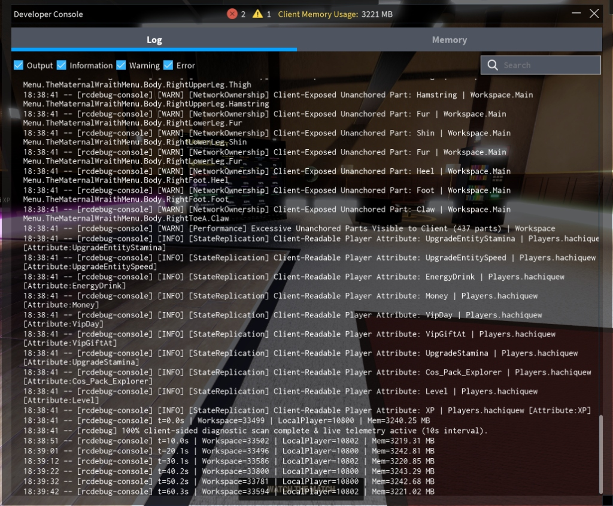
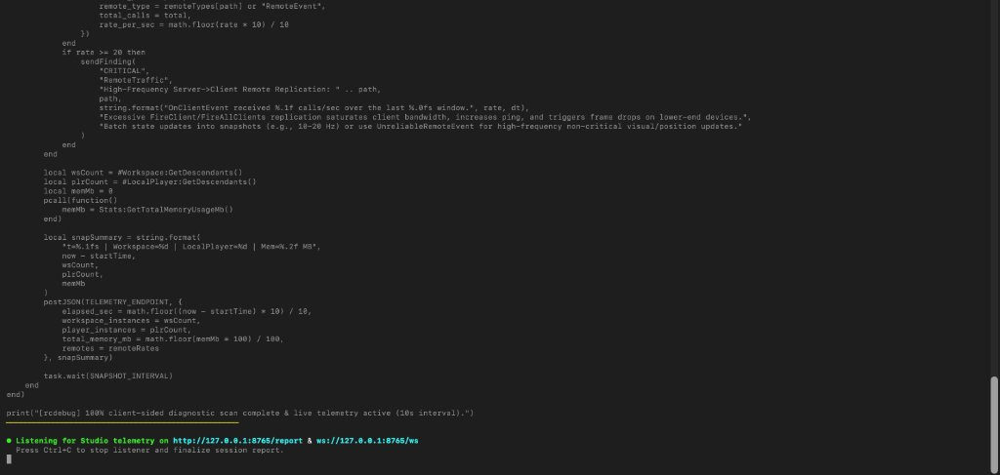

# rcdebug Architecture Reference

<!-- Badgen.net: Package & Release -->
[](https://pypi.org/project/rcdebug/)
[](https://pypi.org/project/rcdebug/)
[](https://github.com/roulettegun/rcdebug/releases)
[](https://github.com/roulettegun/rcdebug/commits/main)

<!-- SpaceBadgers (badgers.space): Architecture Specs -->
[](rcdebug/data/flaws_120000.txt)
[](rcdebug/data/luau_debugger_pack_120.json)
[](rcdebug/flaw_catalog.py)
[](pyproject.toml)

<!-- Shieldcn (shieldcn.dev) & Shields.io -->
[](https://pypi.org/project/rcdebug/)
[](https://github.com/roulettegun/rcdebug/stargazers)
[](https://github.com/roulettegun/rcdebug/actions)

Technical reference for `rcdebug`. Keep this file updated whenever CLI flags, modules, or data files change.





---

## 1. CLI Modes

Running `rcdebug` with no arguments defaults to `--client`.

| Flag | Module | Description |
| :--- | :--- | :--- |
| `--client` | `rcdebug/client_bridge.py` | Starts HTTP/WS listener on `127.0.0.1:8765` (auto-switches to `8766+` if `8765` is busy), copies the client Luau script to clipboard, and tails `~/Library/Logs/Roblox/*_last.log`. |
| `--server` | `rcdebug/mcp_inspector.py` | Audits a live Roblox Studio MCP server or scans local `.rbxlx`, `.rbxmx`, `.luau`, and `.lua` files via `--place <path>`. |
| `--catalog [QUERY]` | `rcdebug/flaw_catalog.py` | Searches `rcdebug/data/flaws_120000.txt` using the mmap index in `~/.rcdebug/index_cache.bin`. |
| `--pack [QUERY]` | `rcdebug/debugger_pack.py` | Searches `rcdebug/data/luau_debugger_pack_120.json` (`LDP-001` to `LDP-120`). |
| `--learn [PATH]` | `rcdebug/learner.py` | Extracts game tokens from a local path, recent Roblox logs, or GitHub (`--learn --github [QUERY]`). |
| `--history` | `rcdebug/learner.py` | Prints `~/.rcdebug/command_history.json` and `FlawBrain` stats. |
| `--watch` | `rcdebug/learner.py` | Polls `command_history.json` and `~/Library/Logs/Roblox/*_last.log` every 2 seconds to learn new tokens. |

---

## 2. File Map

```text
rcdebug/
├── bin/rcdebug                          # Executable linked to ~/.local/bin/rcdebug
├── pyproject.toml                       # PEP 621 package config & console_scripts entrypoint
├── setup.py                             # Setuptools sdist/bdist_wheel builder
├── MANIFEST.in                          # Package data manifest (data/*.txt, data/*.json)
├── LICENSE                              # MIT License
├── README.md                            # User guide & pip install instructions
├── AI_ARCHITECTURE.md                   # Architecture reference
├── .github/workflows/
│   ├── ci.yml                           # Unit test CI workflow
│   └── publish.yml                      # Automated GitHub Release & PyPI publisher on v* tags
├── assets/
│   ├── roblox-devconsole.jpg            # In-game Developer Console telemetry screenshot
│   └── cli-listener.jpg                 # macOS terminal listener screenshot
├── rcdebug/
│   ├── __init__.py                      # __version__ = "1.0.0"
│   ├── cli.py                           # Argument parser, severity filter resolver, history logger
│   ├── models.py                        # Finding, MemorySnapshot, RemoteTrafficStat, AuditSession
│   ├── terminal.py                      # ANSI formatting and pbcopy wrapper
│   ├── exporter.py                      # Markdown report generator (--export)
│   ├── luau_payload.py                  # Client-only Luau scanner script generator
│   ├── client_bridge.py                 # RuntimeBridgeServer, port fallback, RobloxLogTailer
│   ├── mcp_inspector.py                 # StudioMCP client and parallel local file scanner
│   ├── flaw_catalog.py                  # mmap-backed 120,000-flaw catalog + 12 static regex rules
│   ├── debugger_pack.py                 # 120 static Luau probes
│   ├── github_harvester.py              # GitHub REST API Luau harvester
│   ├── learner.py                       # AdaptiveLearner, CommandHistory, AutonomousBrainSync, FlawBrain
│   └── data/
│       ├── flaws_120000.txt             # 120,000 pipe-delimited flaw records (RCD-000001..RCD-120000)
│       └── luau_debugger_pack_120.json  # 120 Luau probes (LDP-001..LDP-120)
├── scripts/
│   └── build_120k_corpus.py             # Deterministic builder for flaws_120000.txt
└── tests/
    └── test_rcdebug.py                  # 15 unit and integration tests
```

### Local State (`~/.rcdebug/`)

- `index_cache.bin`: `marshal` cache containing byte offsets and inverted keyword posting lists for `flaws_120000.txt`, keyed by file size and `mtime_ns`.
- `command_history.json`: Last 500 CLI runs and domain frequency weights.
- `learned_flaws.json` & `learned_patterns.txt`: Custom tokens learned from games and logs.
- `flaw_brain.json`: Token-to-domain and severity weights trained on all 120,000 flaws, 120 probes, and live findings.
- `brain_sync_state.json`: File byte offsets for `AutonomousBrainSync`.

---

## 3. Core Invariants

### A. Client-Only Luau Payload (`luau_payload.py`)
- Uses only client-accessible services: `Players.LocalPlayer`, `ReplicatedStorage`, `ReplicatedFirst`, `Workspace`, `StarterGui`, `StarterPack`, `Lighting`, `SoundService`, `Teams`, `Stats`, `RunService`.
- Never calls server-only APIs (`ServerScriptService`, `ServerStorage`, `OnServerEvent`, `RunService:IsServer()`, `GetNetworkOwner()`) or custom executor hooks (`hookmetamethod`, `getnamecallmethod`).
- Scans `Workspace:GetDescendants()` in batches of `1500` with `task.wait()` yields to prevent client freezes on large maps.
- Sends findings via `HttpService:PostAsync` when available and always prints `[rcdebug-wire:report]`, `[rcdebug-wire:telemetry]`, and `[rcdebug-console]` lines so `RobloxLogTailer` can read them from `~/Library/Logs/Roblox/*_last.log`.

### B. Port Binding Before Clipboard Copy (`client_bridge.py`)
- `bind_runtime_bridge_server()` binds the TCP socket before generating the Luau snippet.
- If `127.0.0.1:8765` is held by an older `rcdebug` process (`GET /status` returns `{"tool": "rcdebug"}`), it sends `POST /shutdown` to reclaim port `8765`.
- If `127.0.0.1:8765` is held by another app (such as MacSploit), it binds `8766` (or the next free port) and writes that port into the copied Luau script.

### C. 120,000-Flaw Ordering & Binary Index (`flaws_120000.txt` + `flaw_catalog.py`)
- Schema: `CODE|SEVERITY|CATEGORY|DOMAIN|KEYWORDS_CSV|TITLE|FLAW|ABUSE|FIX|RANK`
- Strictly ordered by rank `1` to `120000`:
  - `RCD-000001` to `RCD-025000`: `CRITICAL`
  - `RCD-025001` to `RCD-065000`: `WARN`
  - `RCD-065001` to `RCD-120000`: `INFO`
- `FlawCatalog` never loads all 120,000 lines into Python dicts on startup. It loads `~/.rcdebug/index_cache.bin` and seek-reads matching byte offsets from `flaws_120000.txt` via `mmap`.
- Findings sort by `(severity_tier, rank_asc, -confidence, path)` so critical issues always appear first.

---

## 4. Verification

Run before committing changes:

```bash
python3 -m unittest discover -s /Users/revanveroka/Music/rcdebug/tests -v
```
