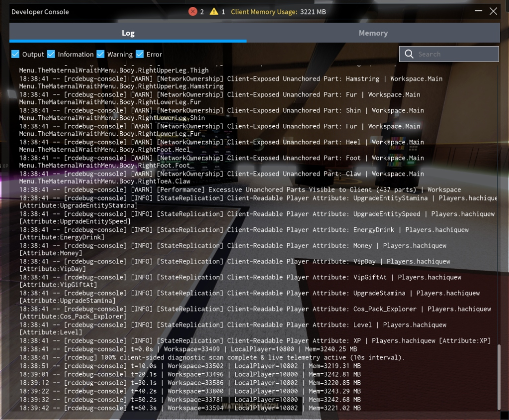

# rcdebug

<!-- Badgen.net (20px): Package & PyPI Metadata -->
[](https://pypi.org/project/rcdebug/)
[](https://pypi.org/project/rcdebug/)
[](LICENSE)
[](https://github.com/roulettegun/rcdebug/commits/main)

`rcdebug` (Revan Cool Debugger) is a zero-dependency macOS CLI debugger and security auditor for Roblox games. It detects exposed remotes, unanchored parts leaking network ownership, replicated player state, memory growth spikes, and insecure server Luau patterns.

---

## Install

<!-- Shieldcn (32px shadcn buttons): GitHub Release & Repository Activity -->
[](https://github.com/roulettegun/rcdebug/releases)
[](https://github.com/roulettegun/rcdebug/stargazers)
[](https://github.com/roulettegun/rcdebug/network/members)
[](https://github.com/roulettegun/rcdebug/issues)

Install from [PyPI](https://pypi.org/project/rcdebug/):

```bash
pip install rcdebug
```

Or install in editable mode from source:

```bash
git clone https://github.com/roulettegun/rcdebug.git
cd rcdebug
pip install -e .
```

---

## Live Preview

| In-Game Developer Console Telemetry | macOS Terminal Bridge Listener |
| :---: | :---: |
|  |  |
| `[rcdebug-console]` findings, `NetworkOwnership` alerts, replicated player attributes, and 10s memory snapshots. | Local HTTP/WS listener auto-copies the client Luau scanner and tails `~/Library/Logs/Roblox/*_last.log`. |

---

## Quick Start

### Live Client Bridge (`--client`, default)

```bash
rcdebug
```

1. Binds `127.0.0.1:8765` (if another process such as MacSploit holds `8765`, it falls back to `8766+` automatically before building the script).
2. Copies a 100% client-sided Luau scanner to your macOS clipboard (`pbcopy`).
3. Tails `~/Library/Logs/Roblox/*_last.log` in real time so telemetry reaches your terminal even when Roblox blocks client `HttpService:PostAsync`.

Paste (`Cmd+V`) the copied Luau script into your executor, Roblox Developer Console, or Studio Command Bar.

### Static Place & Studio MCP Audit (`--server`)

Scan local `.luau`, `.lua`, `.rbxlx`, or `.rbxmx` files in parallel, or connect to an open Roblox Studio MCP session:

```bash
# Audit a local scripts folder or XML place file
rcdebug --server --place ./src --export audit.md

# Auto-discover macOS StudioMCP config and audit the open place
rcdebug --server
```

---

## CLI Reference

| Command | Purpose |
| :--- | :--- |
| `rcdebug` / `rcdebug --client` | Start the live client bridge, copy the Luau scanner, and tail Roblox logs. |
| `rcdebug --server` | Audit a live Roblox Studio MCP session or a local `--place <path>`. |
| `rcdebug --catalog [query]` | Search the 120,000-flaw database (`RCD-000001` to `RCD-120000`). |
| `rcdebug --pack [query]` | Search the 120 static Luau probes (`LDP-001` to `LDP-120`). |
| `rcdebug --learn [path]` | Learn custom remote, attribute, and hierarchy tokens from a place or logs. |
| `rcdebug --learn --github [query]` | Pull public Luau repositories from GitHub into `~/.rcdebug/flaw_brain.json`. |
| `rcdebug --history` | Inspect `~/.rcdebug/command_history.json` and `FlawBrain` stats. |
| `rcdebug --watch` | Continuously sync new commands and Roblox log output into the brain. |

### Common Options

```bash
# Severity filters (combinable)
rcdebug --client --critical
rcdebug --client --critical --warning

# Search catalog with severity & limit filters
rcdebug --catalog datastore --critical --limit 10

# Custom listener port, log replay, or Markdown export
rcdebug --client --port 9000 --replay-log --export report.md

# Offline simulation preview
rcdebug --client --simulate --no-clipboard
```

---

## Auditing Engine

<!-- SpaceBadgers (20px): Auditing Engine Specs -->
[](rcdebug/data/flaws_120000.txt)
[](rcdebug/data/luau_debugger_pack_120.json)
[](rcdebug/flaw_catalog.py)
[](rcdebug/learner.py)
[](rcdebug/luau_payload.py)

- **Exposed Remotes**: Scans `ReplicatedStorage` and `Workspace` for `RemoteEvent`, `RemoteFunction`, and `UnreliableRemoteEvent` instances, classifies risk domains (`Admin`, `Economy`, `DataStore`, `Combat`, `Inventory`), and monitors live `OnClientEvent` rates (`calls/sec`).
- **Network Ownership**: Flags unanchored non-character `BasePart` objects visible to clients (`part:SetNetworkOwner(nil)` remediation).
- **Replicated State**: Surfaces sensitive `ValueBase` objects, `Tool` properties, and player/character attributes exposed to the client.
- **10s Telemetry Diffs**: Tracks `Workspace` instance count, `LocalPlayer` instance count, and `Stats:GetTotalMemoryUsageMb()` every 10 seconds.
- **Static Luau Rules (`--server`)**: Catches `loadstring()`, numeric `require(assetId)`, hardcoded Discord webhooks, `DataStore:SetAsync` without `UpdateAsync`, missing `PurchaseId` checks in `ProcessReceipt`, unguarded `ProximityPrompt.Triggered` / `Touched` events, and `OnServerEvent` handlers missing `typeof()` or cooldown guards.

---

## Project Layout

```text
rcdebug/
├── bin/rcdebug                          # CLI wrapper script
├── assets/                              # README screenshots
├── rcdebug/
│   ├── cli.py                           # Argument parser & command router
│   ├── client_bridge.py                 # HTTP/WS listener, port fallback & log tailer
│   ├── luau_payload.py                  # 100% client-sided Luau scanner generator
│   ├── mcp_inspector.py                 # StudioMCP client & parallel local place/script auditor
│   ├── flaw_catalog.py                  # mmap-indexed 120,000-flaw catalog & 12 static regex rules
│   ├── debugger_pack.py                 # 120 static Luau probes
│   ├── learner.py                       # AdaptiveLearner, CommandHistory & FlawBrain
│   ├── github_harvester.py              # GitHub REST Luau harvester
│   ├── exporter.py                      # Markdown audit report exporter
│   └── data/
│       ├── flaws_120000.txt             # 120,000 ordered flaw records (RCD-000001..RCD-120000)
│       └── luau_debugger_pack_120.json  # 120 static Luau probes (LDP-001..LDP-120)
├── scripts/build_120k_corpus.py         # Deterministic corpus generator
└── tests/test_rcdebug.py                # Unit & integration test suite
```

See [AI_ARCHITECTURE.md](AI_ARCHITECTURE.md) for internal invariants, binary index layout, and maintainer notes.

---

## Tests & CI

<!-- Shields.io (20px flat-square): Build & Runtime Verification -->
[](https://github.com/roulettegun/rcdebug/actions)
[](tests/test_rcdebug.py)
[](pyproject.toml)
[](https://github.com/roulettegun/rcdebug)

```bash
python3 -m unittest discover -s tests -v
```
