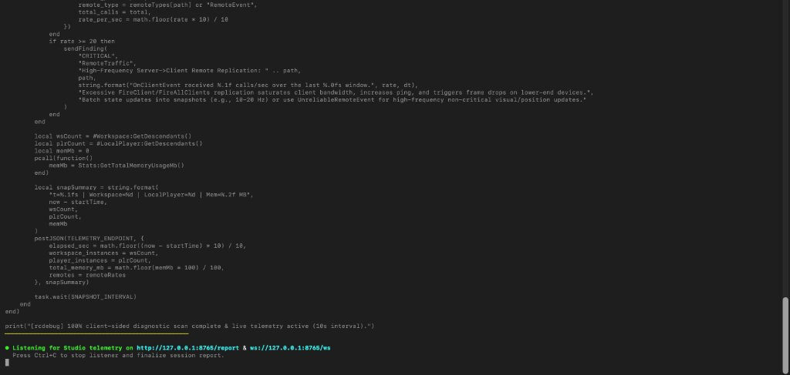

# rcdebug

[](https://pypi.org/project/rcdebug/)
[](https://pypi.org/project/rcdebug/)
[](LICENSE)
[](https://github.com/roulettegun/rcdebug/actions)

`rcdebug` is a macOS command-line debugger and security auditor for Roblox games. It connects to a running Roblox client or Studio session to find exposed remotes, unanchored parts that give nearby clients physics authority, replicated player stats, memory spikes, and server script vulnerabilities.

It uses only the Python standard library and installs zero external dependencies.

<table>
  <tr>
    <td width="52%" valign="top">
      
    </td>
    <td width="48%" valign="top">
      
    </td>
  </tr>
  <tr>
    <td><sub><b>In-game Developer Console:</b> client-side scan &amp; 10s memory diffs</sub></td>
    <td><sub><b>macOS Terminal:</b> local HTTP/WS listener &amp; Roblox log tailer</sub></td>
  </tr>
</table>

## Install

```bash
pip install rcdebug
```

To work from a local checkout:

```bash
git clone https://github.com/roulettegun/rcdebug.git
cd rcdebug
pip install -e .
```

## Usage

### Live Client Audit (`--client`)

Run `rcdebug` with no arguments (or `rcdebug --client`):

```bash
rcdebug
```

`rcdebug` binds a local listener on `127.0.0.1:8765` (switching to `8766` automatically if `8765` is already in use by MacSploit or another process), copies the client-side Luau diagnostic script to your macOS clipboard via `pbcopy`, and tails `~/Library/Logs/Roblox/*_last.log`.

Paste (`Cmd+V`) the copied script into your executor, Roblox Developer Console, or Studio Command Bar. Even when Roblox blocks `HttpService:PostAsync` on the client, `rcdebug` reads the structured `[rcdebug-wire:*]` frames directly from the local Roblox log file.

### Graphical Web Workbench (`--ui`)

Launch the browser-based graphical interface while keeping the live runtime bridge and log tailer active:

```bash
rcdebug --ui
```

`rcdebug --ui` starts the local workbench server (`http://127.0.0.1:8765/ui`, auto-falling back to `8766` if port `8765` is occupied), opens your browser automatically, copies the client Luau diagnostic script to your clipboard, and provides interactive views for live findings (`Developer` vs `Exploit` sub-tabs under `Critical`, `Warning`, and `Info`), a slide-over inspector with 4 domain-tailored overview sections, clickable Studio `Ctrl+Shift+F` search queries, per-finding server Luau fixes, 10-second memory telemetry, static `.luau`/`.rbxlx` scanning, the 120,000-flaw catalog, the 120 Luau probes, and `FlawBrain` history.

### Static Place & Studio MCP Audit (`--server`)

Audit a local directory of `.luau`/`.lua` scripts, an `.rbxlx`/`.rbxmx` place file, or an active Roblox Studio MCP server:

```bash
# Audit a local scripts folder or .rbxlx place file and write a Markdown report
rcdebug --server --place ./src --export audit.md

# Audit an open Roblox Studio session over StudioMCP
rcdebug --server
```

### Knowledge Base & Learning

[](rcdebug/data/flaws_120000.txt)
[](rcdebug/data/luau_debugger_pack_120.json)
[](rcdebug/flaw_catalog.py)

```bash
# Search the 120,000-flaw catalog (RCD-000001 to RCD-120000)
rcdebug --catalog datastore --critical --limit 10

# Search the 120 static Luau probes (LDP-001 to LDP-120)
rcdebug --pack heartbeat

# Learn custom remote and attribute names from a place or recent Roblox logs
rcdebug --learn ./src

# Harvest public Luau scripts from GitHub into ~/.rcdebug/flaw_brain.json
rcdebug --learn --github "roblox remotes"
```

## CLI Reference

| Flag | Description |
| :--- | :--- |
| `--client` | Start the live client bridge, copy the Luau scanner, and tail `~/Library/Logs/Roblox/*_last.log` (default mode). |
| `--ui` | Launch the graphical Web Workbench interface (`http://127.0.0.1:8765/ui`) with live runtime bridge and static scanner. |
| `--server` | Run static checks against Roblox Studio MCP or a local `--place <path>`. |
| `--catalog [QUERY]` | Query `rcdebug/data/flaws_120000.txt` through the `mmap` offset index in `~/.rcdebug/index_cache.bin`. |
| `--pack [QUERY]` | Query `rcdebug/data/luau_debugger_pack_120.json`. |
| `--learn [PATH]` | Extract game-specific tokens from a local path, recent Roblox logs, or GitHub (`--github`). |
| `--history` | Print logged CLI runs (`~/.rcdebug/command_history.json`) and learned token counts. |
| `--watch` | Poll `command_history.json` and Roblox logs continuously in the background. |
| `--critical`, `--warning`, `--info` | Filter terminal and Markdown output by severity (flags can be combined). |
| `--export <FILE.md>` | Save a Markdown report with findings, remediation snippets, remote call rates, and memory diffs. |

## What Gets Audited

1. **Client-Visible Remotes (`ReplicatedStorage` & `Workspace`)**: Flags exposed `RemoteEvent`, `RemoteFunction`, and `UnreliableRemoteEvent` instances, ranks them against the 120,000-flaw index (`Admin`, `Economy`, `DataStore`, `Combat`, `Inventory`), and profiles live `OnClientEvent` traffic (`calls/sec`).
2. **Physics & Network Ownership**: Identifies unanchored non-character `BasePart` instances in `Workspace` that nearby clients can move locally (`part:SetNetworkOwner(nil)` fix).
3. **Replicated Player State**: Checks `Player` and `Character` hierarchies for client-visible `ValueBase` objects (`IntValue`, `NumberValue`, `BoolValue`, `StringValue`), attributes, and `Tool` configurations.
4. **10-Second Memory & Instance Diffs**: Samples `Workspace` instance count, `LocalPlayer` instance count, and `Stats:GetTotalMemoryUsageMb()` every 10 seconds to catch uncleaned instances (`Debris:AddItem`).
5. **Static Server Script Audit (`--server`)**: Scans for `loadstring()`, numeric `require(assetId)`, hardcoded Discord webhooks, `DataStore:SetAsync` without `UpdateAsync`, `ProcessReceipt` handlers missing `PurchaseId` deduplication, unguarded `ProximityPrompt.Triggered` / `BasePart.Touched` connections, and `OnServerEvent` listeners missing `typeof()` or cooldown checks.

## Repository Layout

```text
rcdebug/
├── bin/rcdebug                          # CLI wrapper script
├── pyproject.toml                       # PEP 621 package metadata & console_scripts entrypoint
├── AI_ARCHITECTURE.md                   # Internal architecture & maintainer reference
├── rcdebug/
│   ├── cli.py                           # Argument parser & mode dispatcher
│   ├── ui.py                            # Graphical Web Workbench (--ui) & JSON REST API
│   ├── client_bridge.py                 # Local HTTP/WS listener, port fallback & RobloxLogTailer
│   ├── luau_payload.py                  # Client-sided Luau diagnostic & 10s telemetry generator
│   ├── mcp_inspector.py                 # StudioMCP client & parallel local place/script scanner
│   ├── flaw_catalog.py                  # mmap-indexed 120,000-flaw catalog & 12 static regex rules
│   ├── debugger_pack.py                 # 120 static Luau probes
│   ├── learner.py                       # AdaptiveLearner, CommandHistory & FlawBrain
│   ├── github_harvester.py              # GitHub REST Luau harvester (--learn --github)
│   ├── exporter.py                      # Markdown report writer (--export)
│   └── data/
│       ├── flaws_120000.txt             # 120,000 ordered flaw records (RCD-000001..RCD-120000)
│       └── luau_debugger_pack_120.json  # 120 static Luau probes (LDP-001..LDP-120)
├── scripts/build_120k_corpus.py         # Generator for flaws_120000.txt
└── tests/test_rcdebug.py                # Unit & integration test suite (17 tests)
```

## Tests

```bash
python3 -m unittest discover -s tests -v
```
